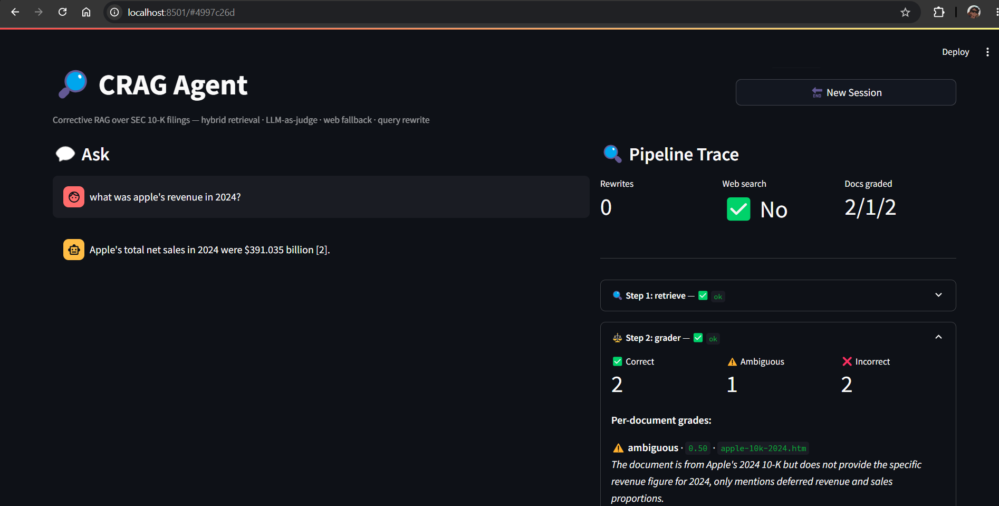
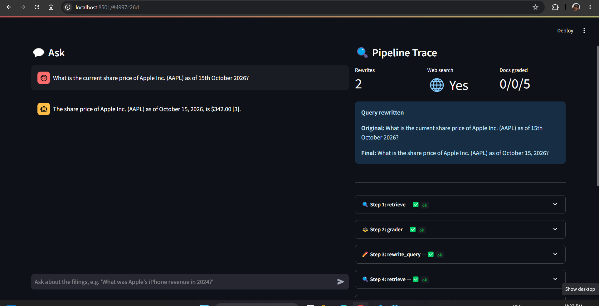
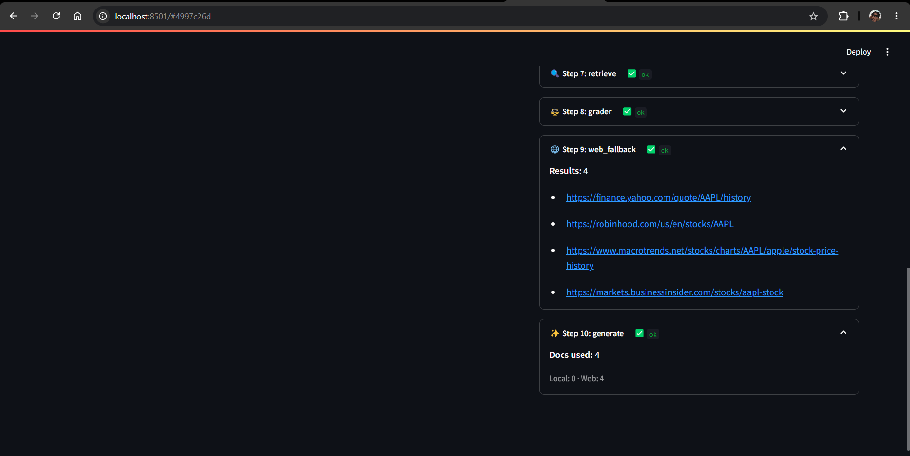
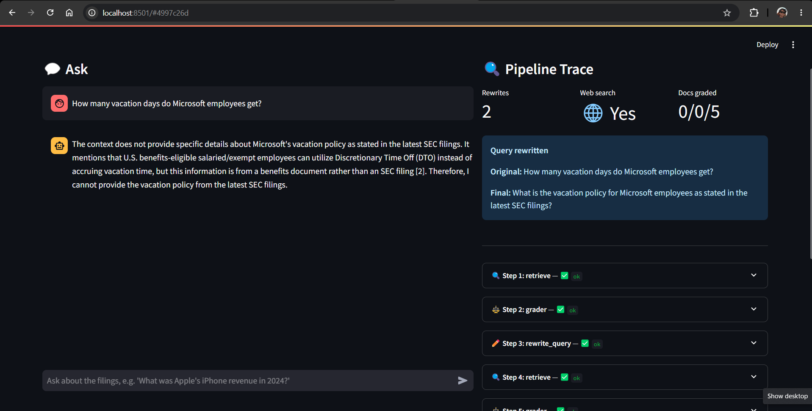
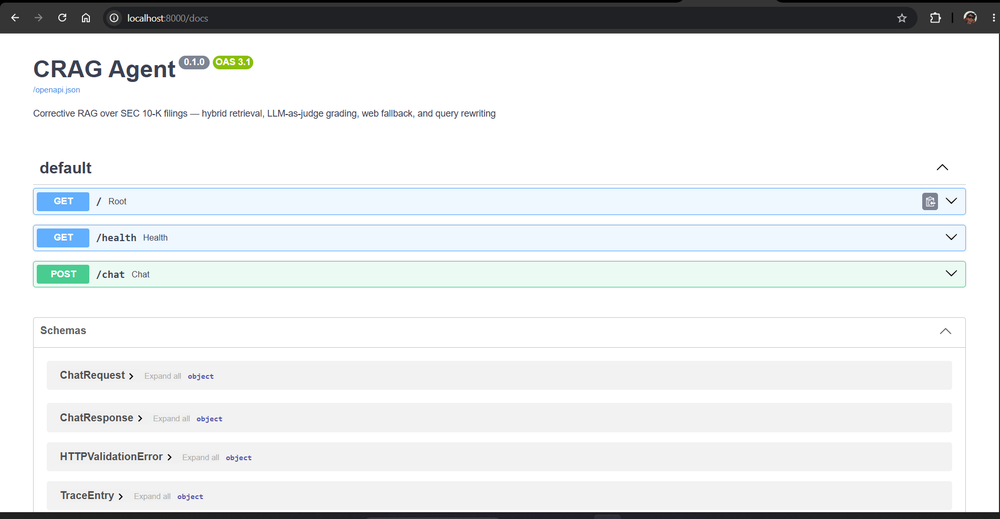
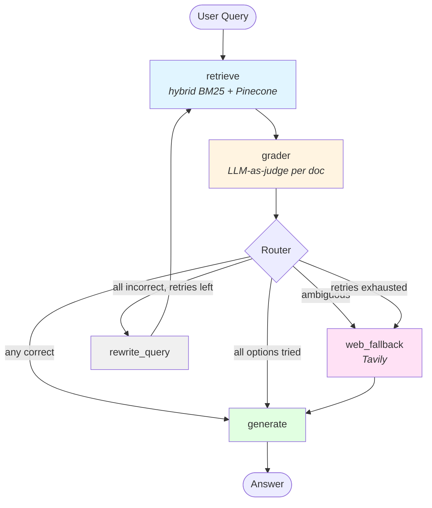

# CRAG Agent

> "A RAG system that knows when it doesn't know. Grades every retrieved document, falls back to web search when local knowledge is insufficient, and refuses to hallucinate."

[](https://www.python.org/downloads/release/python-3120/)
[](https://github.com/langchain-ai/langgraph)
[](https://fastapi.tiangolo.com/)
[](https://docs.ragas.io/)
[](./LICENSE)

## The problem this solves

Naive RAG answers questions by retrieving documents that are *topically similar* to the query. That's fine until it isn't — because "similar" is not the same as "actually answers the question." A filing about Tesla's risk factors looks nearly identical to one about Apple's. A 2024 10-K can't tell you today's stock price. A search for "revenue" surfaces ten chunks and none of them contain the number you asked for.

Most RAG systems just pass the retrieved chunks to an LLM and hope. When the chunks are wrong, the LLM either hallucinates, hedges, or gives an answer from the wrong company.

This project fixes that by adding a **grading layer** between retrieval and generation: every retrieved document is scored by an LLM-as-judge, and the score drives whether the system generates, searches the web, or rewrites the query. The system knows when it doesn't know.

## Who this is for

- **Financial analysts** who need fast, cited answers from SEC filings without opening the 100-page PDF
- **Support teams** building a chatbot over internal documentation that can't afford to hallucinate
- **Product teams** building a "chat with your docs" feature where the documents are heterogeneous (mixed formats, conflicting sources)
- **Anyone building production RAG** who needs retrieval quality to be measurable, not vibes

## How this compares to naive RAG

On 15 verified questions over 3 SEC filings, this pipeline improves **context precision by 19%** by filtering out irrelevant documents before generation. Full evaluation, methodology, and per-question results are in [`eval/comparison.md`](eval/comparison.md).

## What I can build for you

This project is a template. The same architecture applies to:
- Chatbots over company documentation (Notion, Confluence, PDFs)
- Support agents that escalate to humans when needed
- Analyst tools that answer questions with citations
- Any RAG system where hallucination is expensive

**Contact:** [jaskaranjandu4u@gmail.com](mailto:jaskaranjandu4u@gmail.com) · [LinkedIn](https://www.linkedin.com/in/jaskaran-singh-0a65b3181) · [Upwork profile](https://www.upwork.com/freelancers/~01aa522afc2d9a802d)

---

## What it does

- **Hybrid retrieval** — BM25 (sparse) + Pinecone (dense), fused with Reciprocal Rank Fusion
- **Grades every document** — an LLM-as-judge labels each retrieved chunk `correct`, `ambiguous`, or `incorrect`
- **Routes dynamically** — correct docs → generate; ambiguous docs → web fallback; all incorrect → query rewrite
- **Falls back to web search** — Tavily brings in live, current information when the filings can't answer
- **Rewrites the query** — up to two retries, then falls back to web as a last resort
- **Shows its reasoning** — the Streamlit UI renders the full pipeline trace: retrieval, per-doc grades, rewrites, and web sources

---

## Screenshots

### Direct generation — correct chunks exist



The grader marked some chunks `correct`, so the pipeline routed straight to generation. The right panel shows the grade distribution and per-document reasoning.

### Web fallback — no relevant local content




When the query asks about something not in the filings (like today's stock price), the router falls back to Tavily. The trace lists real URLs from the search results.

### Rewrite loop — self-correction in action




For queries the filings simply can't answer, the pipeline rewrites the query up to two times, then falls back to web. The UI shows the original vs. rewritten query side by side.

### FastAPI — interactive API docs



FastAPI auto-generates Swagger UI at `/docs`. Both endpoints (`POST /chat` and `GET /health`) are testable from the browser.

---

## Architecture



**The loop is the point.** `rewrite → retrieve → grade → rewrite` is capped at two iterations. `web_fallback → generate` fires once. Every node emits structured trace entries so the whole flow is inspectable.

---

## Evaluation

CRAG was benchmarked against a naive RAG baseline on 15 verified questions over 3 SEC 10-K filings, using RAGAS across 3 runs per system.

| Metric | Naive RAG | CRAG | Δ |
|--------|-----------|------|---|
| **Context Precision** | 0.562 | **0.669** | **+0.107 (+19%)** |
| Faithfulness | 0.973 | 0.900 | -0.073 (-7.5%) |
| Answer Relevancy | 0.924 | 0.871 | -0.052 (-5.6%) |
| Context Recall | 0.783 | 0.783 | 0.000 |

Variance across runs was negligible (std ≤ 0.013), so these deltas are systematic, not noise.

**The headline:** CRAG improves context precision by 19% by filtering out documents graded as irrelevant. The cost is a small drop in faithfulness — filtering removes chunks that, while marked incorrect, still provided useful contextual redundancy. This is the expected trade-off on a **homogeneous corpus** (three similar filings). On heterogeneous retrieval — web results, mixed documents, contradictory sources — CRAG's precision advantage would be larger and the faithfulness cost smaller.

[Full methodology, per-question results, and raw CSVs →](eval/comparison.md)

---

## Features

- ✅ **Hybrid retrieval** — BM25 + Pinecone, RRF fusion, hash-based dedup
- ✅ **Structured grader** — Pydantic-enforced `Literal` grades, per-document reasoning
- ✅ **Deterministic router** — set-based decision on grade distribution, no extra LLM call
- ✅ **Temporal reasoning** — grader understands that fixed-date filings can't answer present-tense queries
- ✅ **Web fallback** — Tavily search with hardened response normalization (handles any response shape)
- ✅ **Query rewriting** — retries with modified query, capped at 2, with original preserved in state
- ✅ **Graceful failure** — no hallucination when the corpus genuinely can't answer
- ✅ **Full pipeline trace** — every node emits structured observability data
- ✅ **RAGAS evaluation** — 3-run variance analysis, per-question regression debugging
- ✅ **Streamlit trace panel** — grade chips, rewritten query banner, per-doc reasoning, web URLs
- ✅ **Non-root containers** — both images run as `appuser` (UID 1000)
- ✅ **Healthcheck-gated startup** — UI waits for API readiness before starting

---

## Stack

| Layer | Tech |
|-------|------|
| Orchestration | LangGraph 0.2.60 (`StateGraph`, conditional edges, `MemorySaver`) |
| LLM | OpenAI GPT-4o-mini |
| Embeddings | OpenAI `text-embedding-3-small` |
| Vector DB | Pinecone (serverless, `us-east-1`) |
| Sparse retrieval | `rank_bm25` (in-memory BM25) |
| Web search | Tavily via `langchain-tavily` |
| HTML parsing | BeautifulSoup + lxml |
| Evaluation | RAGAS 0.2.x |
| Backend | FastAPI + Uvicorn |
| UI | Streamlit (chat + pipeline trace panel) |
| Containerization | Docker + Docker Compose |
| Runtime | Python 3.12 |

---

## Quickstart

### Prerequisites

- Python 3.12 (not 3.14 — LangChain hasn't caught up)
- Docker Desktop (WSL 2 on Windows)
- OpenAI API key
- Pinecone API key ([free Starter plan](https://www.pinecone.io))
- Tavily API key ([free tier](https://app.tavily.com/sign-in) — 1,000 credits/month)

### Run with Docker

```bash
git clone https://github.com/jaskaranjjk97/CRAG-Agent.git
cd CRAG-Agent
cp .env.example .env
# Edit .env with your keys

docker compose up --build
```

Open **http://localhost:8501**.

### Run locally

```bash
python -m venv .venv
source .venv/bin/activate   # Windows: .venv\Scripts\activate
pip install -r requirements.txt
cp .env.example .env         # add your keys

# One-time: create the Pinecone index
python -m app.pinecone_setup

# One-time: ingest the filings
python -m scripts.ingest_docs --force

# Start the API
uvicorn app.main:app --reload --port 8000

# In a second terminal: start the UI
streamlit run ui/streamlit_app.py
```

### Environment variables

```env
OPENAI_API_KEY=sk-...
OPENAI_MODEL=gpt-4o-mini
EMBEDDING_MODEL=text-embedding-3-small

PINECONE_API_KEY=pc-...
PINECONE_INDEX_NAME=crag-filings
PINECONE_CLOUD=aws
PINECONE_REGION=us-east-1

TAVILY_API_KEY=tvly-...
```

---

## Example traces

**Direct generation (correct chunks exist):**

```
> What was Apple's total net sales in 2024?
trace: ['retrieve', 'grader', 'generate']
grades: correct=2, ambiguous=1, incorrect=1
answer: "Apple's total net sales in 2024 were $391,035 million..."
```

**Web fallback (no relevant local content):**

```
> What is Apple's stock price today?
trace: ['retrieve', 'grader', 'web_fallback', 'generate']
grades: correct=0, ambiguous=0, incorrect=5
web_results: 4 URLs from Tavily
answer: "Apple's current stock price is $342.00 (source: [URL])"
```

**Rewrite loop (self-correction):**

```
> How many vacation days do Microsoft employees get?
trace: ['retrieve', 'grader', 'rewrite',
        'retrieve', 'grader', 'rewrite',
        'retrieve', 'grader', 'web_fallback', 'generate']
rewrites: 2
final_query: "What is the vacation policy for Microsoft employees
              as stated in the latest SEC filings?"
```

---

## Design decisions

### RRF with hashed keys, not content prefixes

The fusion step uses an MD5 hash of the **full chunk content** as the dedup key. The obvious alternative — using the first N characters — collapses chunks from SEC filings because they repeat the same page header ("Apple Inc. | 2024 Form 10-K | 3"). Hashing the full content guarantees that distinct chunks stay distinct.

### The grader receives metadata, not just text

Each grading call includes the source filename and entity ticker. Without them, the LLM can't tell Apple's risk factors from Tesla's — the text is nearly identical across filings. Metadata is what makes entity-aware grading possible.

### The router is a pure function, not an LLM

Routing is a dict lookup on the grade distribution. The grader already did the semantic work; adding an LLM-based router on top would add latency and cost for a decision that's fully determined by the grade counts.

### Web fallback fires after retries, not just on ambiguity

The router originally only triggered web search when at least one doc was `ambiguous`. That missed the case where **all** docs are `incorrect` — exactly when local retrieval has nothing useful. The fix: rewrite up to two times, then fall back to web as a last resort. The distinction is between *ambiguity* (rewriting might help) and *irrelevance* (only external search will help).

### Graceful failure is a feature

When the corpus genuinely can't answer a question, the pipeline returns a canned "I couldn't find reliable information" message rather than letting the LLM improvise. Every behavior that could lead to hallucination has an explicit guard.

### Citation format matters for evaluation

The generator cites sources as `[1]`, `[2]` matching the context block labels — **not** as inline filenames like "(according to apple-10k-2024.htm)". RAGAS's faithfulness metric decomposes answers into atomic claims; a filename fragment looks like an unsupported claim. Fixing the citation format closed a 62% faithfulness gap in the initial evaluation.

---

## Evaluation methodology

15 verified questions, each with a ground-truth answer checked against the ingested chunks. Two systems compared:

- **Naive RAG** — top-5 hybrid retrieval, direct generation, no grading
- **CRAG** — full pipeline with grader, router, and correction loop

Both systems share identical retrieval and generation stacks. The only difference is the correction layer. Three runs per system to establish variance.

RAGAS metrics:
- **Faithfulness** — is each answer claim supported by retrieved context?
- **Answer Relevancy** — does the answer address the question?
- **Context Precision** — what fraction of retrieved chunks were relevant?
- **Context Recall** — did we retrieve all necessary information?

Raw per-run CSVs are in `eval/`. The verification script that confirmed ground truths is in `scripts/verify_eval_set.py`.

---

## Project structure

```
CRAG-Agent/
├── app/
│   ├── config.py                # env + settings
│   ├── llm.py                   # ChatOpenAI factory
│   ├── state.py                 # CRAGState TypedDict
│   ├── parsers.py               # HTML → clean text
│   ├── rag.py                   # hybrid retrieval + RRF
│   ├── pinecone_setup.py        # one-time index creation
│   ├── graph.py                 # StateGraph wiring
│   ├── main.py                  # FastAPI app
│   └── nodes/
│       ├── grader.py            # LLM-as-judge per doc
│       ├── router.py            # conditional routing logic
│       ├── web_fallback.py      # Tavily search wrapper
│       ├── rewrite.py           # query rewriter
│       └── generate.py          # grounded answer synthesis
├── data/
│   └── filings/                 # SEC 10-K HTML files
│       ├── apple-10k-2024.htm
│       ├── microsoft-10k-2024.htm
│       └── tesla-10k-2024.htm
├── eval/
│   ├── README.md                # eval folder guide
│   ├── comparison.md            # metric comparison + interpretation
│   ├── questions.json           # 15-question eval set
│   ├── eval_naive.csv           # latest naive run
│   ├── eval_crag.csv            # latest CRAG run
│   └── eval_{system}_run{1,2,3}.csv
├── scripts/
│   ├── ingest_docs.py           # one-shot Pinecone ingest
│   ├── pinecone_setup.py        # index creation
│   ├── run_graph.py             # CLI demo
│   ├── verify_eval_set.py       # ground-truth verification
│   ├── evaluate.py              # RAGAS benchmark
│   ├── diagnose_eval.py         # per-question diff
│   ├── debug_regression.py      # side-by-side answer comparison
│   └── compare_runs.py          # 3-run variance analysis
├── tests/
│   ├── test_rag.py
│   ├── test_grader.py
│   ├── test_crag.py
│   └── test_setup.py
├── ui/
│   └── streamlit_app.py         # chat + pipeline trace panel
├── docs/
│   ├── 01-direct-generate.png
│   ├── 02-web-fallback.png
│   ├── 03-rewrite-loop.png
│   └── 04-swagger.png
├── Dockerfile                   # backend image
├── Dockerfile.ui                # UI image
├── docker-compose.yml           # orchestration
├── requirements.txt
├── .env.example
├── .gitignore
├── .dockerignore
├── pyproject.toml               # ruff config
└── README.md
```

---

## Roadmap

- [x] HTML parsing for 10-K filings
- [x] Hybrid retrieval (BM25 + Pinecone with RRF)
- [x] LLM-as-judge grader with structured output
- [x] Router with dynamic correction
- [x] Web fallback via Tavily
- [x] Query rewriting with retry cap
- [x] Grounded generation with citations
- [x] FastAPI backend
- [x] Streamlit UI with pipeline trace
- [x] RAGAS evaluation with variance analysis
- [x] Docker + Compose
- [ ] Azure Container Apps deployment
- [ ] Heterogeneous corpus eval (web + filings mixed)
- [ ] LLM-based reranker for retrieval
- [ ] Batch grading for reduced latency

---

## Limitations

Honest about what this demo doesn't do:

- **BM25 is in-memory** — rebuilds on process restart. Fine for 1,500 chunks; at production scale, use Pinecone's native sparse index or Elasticsearch.
- **Truncation at 300K chars/filing** — real 10-Ks run 500K-800K chars after HTML parsing. The current cap keeps ingest fast and covers the MD&A section, but drops later exhibits.
- **No ground-truth verification for all questions** — 15 questions was a directional signal, not statistical rigor. Production would use 100+ questions with human-verified ground truths.
- **RAGAS has non-determinism** — the LLM-as-judge evaluator varies slightly across runs. We measured this with 3 runs (std ≤ 0.013), but tighter confidence intervals would need 10+.
- **No authentication** — the API has no auth layer. Production would add JWT or API-key middleware.
- **English only** — prompts assume English. Multilingual would need per-language few-shot examples.

---

## License

MIT — see [LICENSE](./LICENSE).